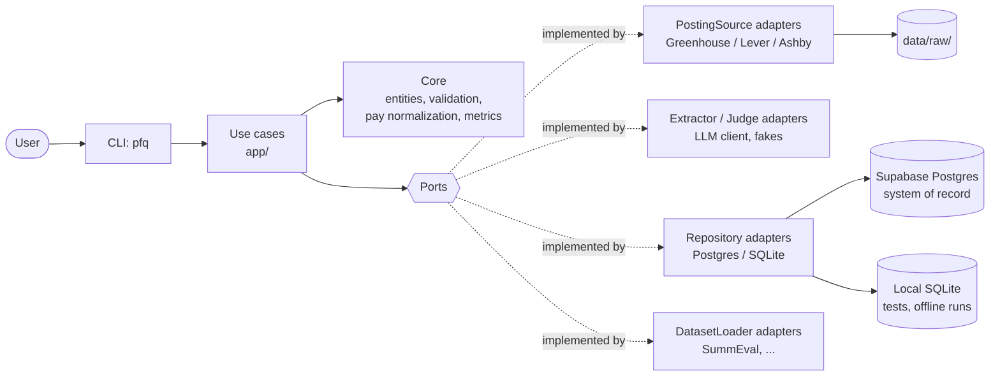

# Architecture

> **Status:** Sprint 1 draft. This is the intended design; nothing below is implemented yet unless marked otherwise. Open decisions are marked **TBD** and collected in [Open Decisions](#open-decisions).

## Overview

The system has two pipelines that share one database and meet at the analysis layer:

- **Market side (price of expertise):** public postings → raw snapshot → LLM extraction → Core validation and pay normalization → `posting` / `pay_quote` → SQL analysis.
- **Quality side (value of expertise):** public multi-rater dataset → `item` / `rater` / `label` → Core agreement and rater-quality metrics → expert vs. crowd vs. LLM judge.

The code follows a ports-and-adapters layout. A pure **Core** holds all rules and math. **Use cases** orchestrate the Core through **ports** (interfaces). **Adapters** implement the ports for the outside world (HTTP, Supabase Postgres, SQLite, LLM APIs, dataset files). The **CLI** is the user-facing boundary and the only place where concrete adapters are wired together.



Dependencies point inward only: `cli → app → core`, and `adapters → core` (adapters implement ports defined in Core). Core imports nothing from `app`, `adapters` or `cli`.

## Components and Responsibilities

| Layer               | Package (planned)               | Responsibility                                                                                                                                              | May import                                       |
| ------------------- | ------------------------------- | ----------------------------------------------------------------------------------------------------------------------------------------------------------- | ------------------------------------------------ |
| **Core**      | `paying_for_quality.core`     | Domain entities, validation of LLM candidates, pay normalization, agreement and rater-quality metrics, port definitions                                     | Python standard library only                     |
| **Use cases** | `paying_for_quality.app`      | One function/class per user action (collect, extract, review, ingest, evaluate, query, report). Calls ports and Core; owns transactions and run bookkeeping | `core`                                         |
| **Adapters**  | `paying_for_quality.adapters` | HTTP posting sources, LLM extractor and judge clients, Postgres and SQLite repositories, dataset loaders, fakes for tests                                  | `core`, third-party libraries (each justified) |
| **CLI**       | `paying_for_quality.cli`      | Parse arguments, build adapters from config (composition root), call one use case, format output and exit code                                              | `app`, `adapters`, `core` types            |

Planned module layout:

```
src/paying_for_quality/
  core/
    entities.py      # dataclasses: Posting, PayQuote, Item, Rater, Label, ...
    pay.py           # unit conversion and hourly normalization
    validation.py    # accept/reject/review LLM extraction and judge candidates
    agreement.py     # Cohen's / Fleiss' kappa, Krippendorff's alpha, scorecards
    ports.py         # Protocol classes (see Ports)
    errors.py        # domain errors and validation issue codes
  app/
    market.py        # collect, extract, review use cases
    quality.py       # ingest dataset, evaluate raters, run judge
    reporting.py     # named queries and report assembly
  adapters/
    sources/         # greenhouse.py, lever.py, ashby.py
    llm/             # extractor.py, judge.py, fake.py
    storage/         # postgres_repository.py (Supabase), sqlite_repository.py (local/tests)
    datasets/        # summeval.py, ...
  cli.py             # `pfq` entry point and wiring
data/schema/
  postgres.sql       # Supabase schema (committed)
  sqlite.sql         # same tables/columns for local runs and tests (committed)
tests/               # pytest
```

### Core rules (the Engineering Core)

These are the behaviors the course's Engineering Core refers to. All are pure functions over plain data and are unit-testable without a database, network or API key.

1. **Pay normalization.** Convert a pay quote to an hourly USD figure.
   - Units and default conversions: `hour` ×1, `day` ÷8, `week` ÷40, `month` ÷(2080/12), `year` ÷2080. Constants live in one place in `core/pay.py` and are documented, not scattered.
   - `task` / `project` units are normalized only when the posting states a time per task; otherwise the quote is kept with `hourly_usd = NULL` and an issue code (`UNIT_NOT_NORMALIZABLE`).
   - Ranges keep both ends (`hourly_min_usd`, `hourly_max_usd`); a single figure sets both.
   - Non-USD currencies: **TBD** (flag and skip, or convert with a dated rate table).
2. **Extraction validation.** Turn an `ExtractionCandidate` from the LLM into an accepted `Posting`, a rejection, or a review item. Checks include: required fields present; amounts positive and `min ≤ max`; unit in the allowed set; each pay figure backed by an evidence quote that actually appears in the raw text (guards against invented numbers); hourly result inside a plausibility band (band **TBD**); model confidence above a threshold (threshold **TBD**). Every failure produces a named issue code, not a free-text message.
3. **Agreement and rater quality.** Cohen's kappa (two raters), Fleiss' kappa and Krippendorff's alpha (many raters, missing labels allowed), per-rater scorecards (agreement with leave-one-out consensus or with expert consensus), and ambiguous-item detection (low per-item agreement).
4. **Judge validation.** An LLM judge score is accepted only if it is on the dataset's scale and parses cleanly; otherwise it is stored as a failed judge result and excluded from metrics.

**Rule: LLM output is untrusted.** Extractor and Judge adapters return *candidates*. Only Core validation turns a candidate into a value that is stored in an analysis table or shown to a user.

## Ports

Ports are `typing.Protocol` classes in `core/ports.py`. Use cases depend on these, never on concrete adapters. Every port has a fake used in tests.

| Port              | Method(s) (sketch)                                             | Real adapter                                                                           | Test fake                                       |
| ----------------- | -------------------------------------------------------------- | -------------------------------------------------------------------------------------- | ----------------------------------------------- |
| `PostingSource` | `list_postings() -> Iterable[RawPostingDoc]`                 | Public job-board APIs (Greenhouse, Lever, Ashby; per-source terms check **TBD**) | Fixed list of documents                         |
| `Extractor`     | `extract(raw_text: str) -> ExtractionCandidate`              | LLM client (provider **TBD**)                                                    | Returns scripted candidates, including bad ones |
| `Judge`         | `score(item: Item, rubric: Rubric) -> JudgeCandidate`        | LLM client (provider **TBD**)                                                    | Returns scripted scores                         |
| `DatasetLoader` | `load() -> DatasetBundle` (dataset, items, raters, labels)   | One per public dataset (SummEval first)                                                | Small hand-made bundle                          |
| `Repository`    | save/get for each aggregate; `run_named_query(name, params)` | Supabase Postgres; SQLite for local runs                                               | Temporary SQLite file or dict-backed fake       |

`Repository` may later split into `MarketRepository` and `QualityRepository` if it grows too large; that split is a refactor, not a design change.

## Interface / API Boundary

The primary boundary is **CLI → use cases**. Each command builds a small request object, calls one use case, and receives a result object. The CLI never runs SQL, never calls an LLM, and never does pay or agreement math.

What crosses the boundary:

- **In:** plain request dataclasses (e.g. `ExtractRequest(limit=50, model="...")`) built from validated CLI arguments and config.
- **Out:** plain result dataclasses (counts accepted / rejected / sent to review, issue codes, query rows, report paths). The CLI formats these as text tables or JSON (`--json`).
- **Errors:** domain and validation errors are returned as data or raised as typed exceptions from `core/errors.py`; the CLI maps them to messages and exit codes. Stack traces are not shown to the user by default.

Why it is useful: the same use cases can later sit behind a web UI or a scheduled job without change; tests can call use cases directly with fakes; and the CLI is thin enough to test with a few smoke tests.

The second boundary is **use cases → ports**. It keeps the Core testable without network or database, and lets a real LLM be swapped for a fake (or for a different provider) through configuration.

### Planned CLI commands

| Command                                         | Use case                                                                     | Target sprint |
| ----------------------------------------------- | ---------------------------------------------------------------------------- | ------------- |
| `pfq init-db`                                 | Create or upgrade the schema in the configured database                      | S2            |
| `pfq collect --source <name>`                 | Pull postings from one source; store new or changed snapshots                | S2            |
| `pfq extract [--limit N] [--fake]`            | Run extraction on unprocessed snapshots; validate; store or queue for review | S2            |
| `pfq review list \| accept <id> \| reject <id>` | Work the low-confidence review queue                                         | S3            |
| `pfq query <name> [--param k=v]`              | Run a named, committed SQL analysis                                          | S2            |
| `pfq ingest <dataset>`                        | Load a public multi-rater dataset                                            | S4            |
| `pfq evaluate --dataset <name>`               | Agreement metrics, rater scorecards, expert vs. crowd; optional judge run    | S4–S5        |
| `pfq report`                                  | Assemble the price-vs-value summary from Core results and SQL                | S5            |

Exit codes: `0` success; `1` handled error (validation, missing data, external service failure); `2` usage error (argparse default).

## Data Sources

### Source census (2026-11-09)

Method: `scripts/source_census.py` queries the public job-board APIs for about 15 AI human-data companies, using one request per second and a generic client name. It prints counts only and stores nothing.

| Board | Company | Postings | With $ pay | With hourly pay |
|---|---|---|---|---|
| Greenhouse `scaleai` | Scale AI | 170 | 117 | 6 |
| Ashby `mercor` | Mercor | 86 | 86 | 6 |
| Ashby `handshake` | Handshake | 77 | 73 | 3 |
| Greenhouse `turing` | Turing | 46 | 23 | 0 |
| Greenhouse `snorkelai` | Snorkel AI | 43 | 42 | 1 |
| Ashby `surge-ai` | Surge AI | 35 | 0 | 0 |
| Greenhouse `prolific` | Prolific | 25 | 3 | 0 |
| Greenhouse `invisibletech` | Invisible | 20 | 14 | 0 |
| Greenhouse `toloka` | Toloka | 16 | 0 | 0 |
| Greenhouse `labelbox` | Labelbox | 10 | 8 | 0 |

No public board was found for micro1, DataAnnotation, Outlier or Alignerr.

**Finding: the market has two segments.** The public job-board APIs list mostly **staff roles**, meaning the companies' own employees, paid annual salaries. The **expert contractor gigs**, which are what "price of expertise" most directly means, are mostly on the companies' own platform sites (work.mercor.com, outlier.ai, dataannotation.tech, alignerr.com). Those need a per-site terms review before any collection. The data model records a `segment` (`staff` / `expert`) per source.

### Terms and robots checks

| Host | robots.txt | Provider docs |
|---|---|---|
| `boards-api.greenhouse.io` | Allows everything except `/embed/` | "Job Board data is publicly available, so authentication is not required for any GET endpoints." No rate limits or terms page linked |
| `api.ashbyhq.com` | None (401) | Unauthenticated GET. Described as a feed for an organization's own careers page. No rate limits, no terms page, no third-party restrictions stated |
| `work.mercor.com` | Allows `/` but disallows `/api/` | Terms not yet read |
| `outlier.ai`, `alignerr.com`, `dataannotation.tech` | Allow general crawling | Terms not yet read |

Neither provider prohibits or invites third-party use. Collection therefore stays minimal: one request per board per run, about weekly, with a generic client name, only listed postings, and no application endpoints.

### Chosen sources

- **Sprint 2:** Ashby, for Mercor and Handshake. It has structured compensation (`compensation.summaryComponents[]` with type, interval, currency, min and max) and plain-text descriptions, and it includes the strategy and ops roles this project's owner is targeting.
- **Backup:** Greenhouse, for Scale AI. Pay appears in the description text only.
- **Sprint 3:** review the expert-gig platforms' terms; add any that allow collection.

The registry lives in `data/sources.toml`. A source with `terms_checked = false` cannot be collected.

## Data Model and Persistence Plan

### Database approach

Hybrid: one `Repository` port, two adapters, chosen by `DATABASE_URL` in `.env`.

| | Supabase Postgres | Local SQLite |
|---|---|---|
| Role | System of record for collected and cleaned data; where weekly collection writes; where the SQL analyses run | Automated tests and offline/demo runs; lets a reviewer run the tool with no credentials |
| `DATABASE_URL` | `postgresql://...` connection string from the Supabase dashboard (session pooler if the network is IPv4-only) | `sqlite:///./pfq.db` (file git-ignored) |
| Driver | Postgres driver (see Dependencies) over the connection string, **not** the Supabase REST client, so SQL stays the interface | Standard-library `sqlite3` |
| Schema | `data/schema/postgres.sql` | `data/schema/sqlite.sql` |

- **Plain SQL, kept portable.** Both schema files define the same tables and columns. A test checks that they stay in sync. Dialect differences (identity columns, `timestamptz` vs. ISO-8601 text, `jsonb` vs. text, parameter style) stay inside the adapters. Named analysis queries use the shared subset of SQL. Any query that needs Postgres-only features is marked as Postgres-only.
- **IDs:** integer surrogate keys on every table (`GENERATED ALWAYS AS IDENTITY` in Postgres, `INTEGER PRIMARY KEY` in SQLite), plus `UNIQUE` constraints on natural keys so re-running a command is idempotent.
- **Timestamps** are UTC.
- **Schema version** is tracked in a one-row `schema_version` table; `pfq init-db` applies the schema. Foreign keys are enforced in both databases (`PRAGMA foreign_keys = ON` in SQLite).
- **Supabase exposure.** Tables live in a dedicated `pfq` schema rather than `public`, so they are not served by Supabase's auto-generated Data API. Row Level Security is enabled as a second guard. Only the server-side connection string is used; no anon or service keys are needed.
- **Three layers:** **raw** (what was fetched), **cleaned** (Core-validated rows), **analysis** (SQL views over cleaned rows only).

### Market tables

| Table              | Key fields                                                                                                                                                                     | Notes                                                                                                                                                                                                                |
| ------------------ | ------------------------------------------------------------------------------------------------------------------------------------------------------------------------------ | -------------------------------------------------------------------------------------------------------------------------------------------------------------------------------------------------------------------- |
| `source`         | `id`, `slug` (unique), `kind` (greenhouse/lever/ashby/...), `base_url`, `robots_checked_at`, `terms_note`                                                          | One row per collected board; records the robots.txt / terms check required by `AGENTS.md` §4                                                                                                                      |
| `collection_run` | `id`, `source_id`, `started_at`, `finished_at`, `status`, `n_new`, `n_unchanged`, `error`                                                                      | One row per `pfq collect` run; observability for weekly collection                                                                                                                                                 |
| `raw_posting`    | `id`, `source_id`, `external_id`, `content_hash`, `raw_path`, `url`, `first_seen_at`, `last_seen_at`                                                           | Unique on (`source_id`, `external_id`, `content_hash`). Unchanged content only bumps `last_seen_at`; changed content inserts a new row. Body stored as a file under `data/raw/<source>/<hash>`, not in git |
| `extraction_run` | `id`, `raw_posting_id`, `extractor` (model or `fake`), `prompt_version`, `created_at`, `candidate_json`, `outcome` (accepted/rejected/review), `issues_json` | Audit trail: the untrusted LLM output is kept verbatim next to Core's verdict                                                                                                                                        |
| `posting`        | `id`, `raw_posting_id`, `extraction_run_id`, `company`, `platform`, `title`, `domain`, `seniority`, `credentials_json`, `posted_at`                        | Only Core-accepted extractions. Latest accepted run per `raw_posting` is current                                                                                                                                   |
| `pay_quote`      | `id`, `posting_id`, `amount_min`, `amount_max`, `currency`, `unit`, `hourly_min_usd`, `hourly_max_usd`, `evidence`                                           | 0..n per posting (e.g. tiers or regions). `hourly_*` are NULL when not normalizable                                                                                                                                |
| `review_item`    | `id`, `extraction_run_id`, `status` (open/accepted/rejected), `decided_at`, `note`                                                                                   | Low-confidence or failed extractions waiting for a human decision; also feeds the extraction-accuracy evaluation                                                                                                     |

### Quality tables

| Table         | Key fields                                                                                                                | Notes                                                                                                                                      |
| ------------- | ------------------------------------------------------------------------------------------------------------------------- | ------------------------------------------------------------------------------------------------------------------------------------------ |
| `dataset`   | `id`, `slug` (unique), `name`, `license`, `source_url`, `origin` (public/synthetic)                           | License recorded per `AGENTS.md` §4.6                                                                                                   |
| `item`      | `id`, `dataset_id`, `external_id`, `payload_json`                                                                 | Unique on (`dataset_id`, `external_id`)                                                                                                |
| `rater`     | `id`, `dataset_id`, `external_id`, `kind` (expert/crowd/llm_judge)                                                | LLM judges are raters, so all agreement code treats them the same way                                                                      |
| `label`     | `id`, `item_id`, `rater_id`, `criterion`, `value`                                                               | Unique on (`item_id`, `rater_id`, `criterion`); `criterion` covers multi-aspect datasets (e.g. SummEval's coherence, fluency, ...) |
| `judge_run` | `id`, `dataset_id`, `rater_id`, `model`, `prompt_version`, `created_at`, `n_ok`, `n_failed`, `cost_usd` | Bookkeeping for each LLM-judge pass; the judge's accepted scores land in `label`                                                         |

### Relationships

- `source 1─n raw_posting 1─n extraction_run`; an accepted run yields `1 posting 1─n pay_quote`; a review outcome yields `1 review_item`.
- `dataset 1─n item`, `dataset 1─n rater`, `item n─n rater` through `label`.
- Market and quality families share no foreign keys. They meet in analysis views and in the report, joined on `domain` (e.g. posting domain "medicine" vs. dataset domain). That domain vocabulary is **TBD**.

### What persists vs. what is transient

| Persists (database or `data/raw/`)                | Transient (never stored)                                               |
| --------------------------------------------------- | ---------------------------------------------------------------------- |
| Raw posting snapshots and their hashes              | HTTP sessions, retries, rate-limit state                               |
| Every extraction candidate, verdict and issue codes | Prompts after rendering (only `prompt_version` is stored)            |
| Accepted postings and pay quotes                    | Agreement metrics and scorecards (recomputed from `label` on demand) |
| Review decisions                                    | Intermediate dataframes / query results                                |
| Dataset items, raters, labels; judge runs and costs | API keys and other secrets (only in `.env`, never in the DB or logs) |

Metrics are recomputed rather than stored so that they always match the current labels. If a computation becomes slow, a cached results table can be added later.

**Non-public rater data** (synthetic data now; the research experiment later, only after approval) goes in a **separate database** (its own Supabase project or local SQLite file) with the same schema and `dataset.origin` set accordingly, so it never mixes with public data (`AGENTS.md` §4.5). The future 2×2 experiment is then a new dataset plus a `condition` attribute on items or raters, not a new architecture.

## Verification Approach by Layer

| Layer           | How it is tested                                                                                                    | Needs DB / network / key? |
| --------------- | ------------------------------------------------------------------------------------------------------------------- | ------------------------- |
| Core            | Unit tests on pay normalization, validation issue codes, agreement metrics against hand-computed or textbook values | No                        |
| Use cases       | Tests with fake `PostingSource`, `Extractor`, `Judge` and an in-memory repository                             | No                        |
| SQLite adapter  | Tests against a real temporary SQLite file (schema applies; unique constraints make re-runs idempotent)             | Local file only           |
| Postgres adapter | The same repository test suite, run against Supabase only when `PFQ_TEST_DATABASE_URL` is set (marked `@pytest.mark.supabase`, skipped otherwise) | Yes (opt-in)              |
| Schema parity   | Test that `postgres.sql` and `sqlite.sql` declare the same tables and columns                                       | No                        |
| CLI             | Smoke tests calling `main(argv)` with fakes wired in; check exit codes and output                                 | No                        |
| Real LLM / HTTP | Manual or opt-in runs only, recorded in `docs/sprint-status.md`                                                   | Yes                       |

Test runner: **pytest**. The default command (`pytest` from the repo root) needs no network, Supabase credentials or API key. The verification intent for specific behaviors lives in `docs/requirements.md`.

## Dependencies

Policy: **Core stays standard-library only, permanently.** Adapters and analysis may add a dependency only when the standard library is clearly worse, and each one is listed here with its reason.

| Dependency | Status | Used by | Why |
|---|---|---|---|
| `pytest` (dev only) | Decided | Tests | Clearer assertions and fixtures than `unittest`; markers keep opt-in Supabase tests out of the default run |
| Postgres driver (e.g. `psycopg`) | Decided in principle; exact package **TBD** | Postgres repository adapter | Python's standard library cannot talk to Postgres; Supabase requires it |
| HTTP client | **TBD** | Posting sources | `urllib` may be enough for public JSON job-board APIs |
| LLM provider SDK | **TBD** | Extractor / Judge adapters | Depends on provider choice; plain HTTP is the alternative |
| numpy / pandas / statsmodels | **TBD**, Exploration Zone | Hedonic regression | Only if the regression moves into scope |

## Open Decisions

| # | Decision                                                  | Default until decided                    |
| - | --------------------------------------------------------- | ---------------------------------------- |
| 1 | LLM provider and model (a low-cost "flash"-class model is the leading option); exact monthly cap (low) | Fake extractor/judge only |
| 2 | Exact Postgres driver package; HTTP client; LLM SDK       | Standard library where possible          |
| 3 | Non-USD pay handling                                      | Flag and exclude from hourly figures     |
| 4 | Plausibility band and confidence threshold for extraction | Sent to review when unsure               |
| 5 | Shared domain vocabulary linking postings and datasets    | —                                       |
| 6 | Which posting sources pass the robots.txt / terms check   | Determined by the Sprint 1 source census |

**Decided in Sprint 1:** Supabase Postgres as the system of record with local SQLite for tests (hybrid); pytest as the test runner.

## What Changed This Sprint

**Sprint 1:** first draft of components, ports, CLI boundary, data model and persistence plan. Database changed from SQLite-only to Supabase Postgres plus local SQLite behind one `Repository` port; pytest chosen. No code yet.
